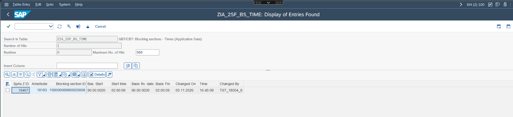

# JADE-1777: Invalid TS date/time in workplace details

## Issue
For GBT shift `29.11.2026`, the TS row displays `90.00.0020 02:00:09 - 02:00:09` instead of the valid interval dates/times.

## Evidence
System/client: `I04 / 100`. Shift: `001500000099`; workplace: `18193`; workplace-time record: `18467`.

Both compared structures reference `SPERRAS_ID = 00150000009900020009`, interval type `TS`, blocking section `W`.

| Field | Shift interval `<LS_SP_SCHICHT>` | Workplace-time object `LS_SP_ZEIT` |
|---|---|---|
| `START_DATUM` | `20261129` (29.11.2026) | `00200090` (invalid) |
| `START_ZEIT` | `234000` (23:40:00) | `020009` (02:00:09) |
| `END_DATUM` | `20261130` (30.11.2026) | `00200090` (invalid) |
| `END_ZEIT` | `051000` (05:10:00) | `020009` (02:00:09) |

SE16N confirms the same bad values are persisted in `ZIA_2SF_BS_TIME`, record `18467`, last changed `05.11.2026 16:45:09`.

### SE16N entry
Open table **`ZIA_2SF_BS_TIME`** in system **`I04`**, client **`100`**, and filter **`SP_ZEITEN_ID = 18467`**.

| Field | Entry value |
|---|---|
| `SP_ZEITEN_ID` | `000000018467` |
| `ZARBSTL` | `000000018193` |
| `SPERRAS_ID` | `00150000009900020009` |
| `START_DATUM` / `END_DATUM` | Raw `00200090`; displayed `90.00.0020` |
| `START_ZEIT` / `END_ZEIT` | Raw `020009`; displayed `02:00:09` |
| `AEDAT` / `AETIM` | `20261105` / `164509` |

## Cause / ownership
**Confirmed by debugging:** invalid dates/times are already persisted. `GET_SP_DETAILS_WD` builds the row from the workplace-time object; `ZCL_IA_2RESTR_ASSO_TIMS->GET_DATA` returns those values without conversion. The controller binds the result to the screen. The application is displaying bad data, not introducing it through display formatting.

**User clarification:** this entry comes from outside the shift-planning application. The external writer owns investigation of how the invalid values were created and prevention of recurrence. That writer's implementation has not been inspected.

## Resolution
Have the responsible team confirm the intended workplace dates/times and correct record `18467` through an approved process. The source TS interval above is comparison evidence, not a confirmed business requirement for workplace times.

After correction, start a fresh application session and reopen the shift; the workplace-time object is cached. Correcting the data should resolve this display instance. Prevention depends on correcting the external writer if it can produce invalid values again.

## Provisional code change - not the task1777 fix
A local, unverified patch remains in `ZCL_IA_2RULES\ZCL_IA_2WRKPLACE.abap`: `SELECT_SP_SCHICHT` uses `GET_SP_SCHICHT` instead of reading `ZIA_2SF_BS_TIME` into a `ZIA_2SF_BS` structure; its caller skips missing intervals.

This is a separate code finding, not the confirmed cause of this incident. **Do not transport the patch as the task1777 fix.** No code was reverted as part of this documentation update.

## Verification / impact
**Data correction and verification pending.** An authorized person should confirm the corrected database values and reopened display, then verify the external process preserves valid dates/times.

The affected shift is released and the user cannot edit it. Do not bypass release restrictions or perform unauthorized database edits.
